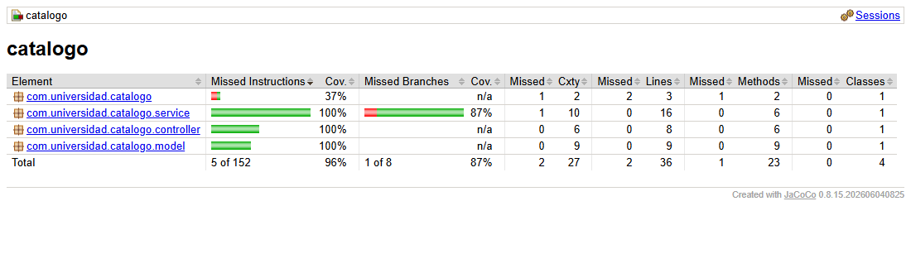
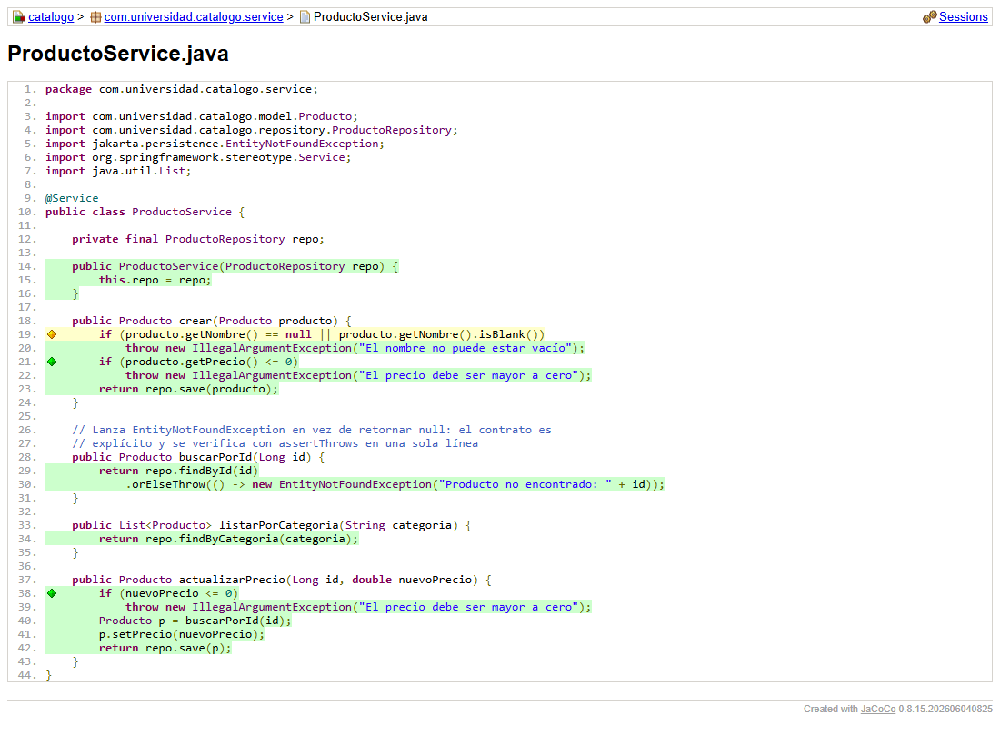
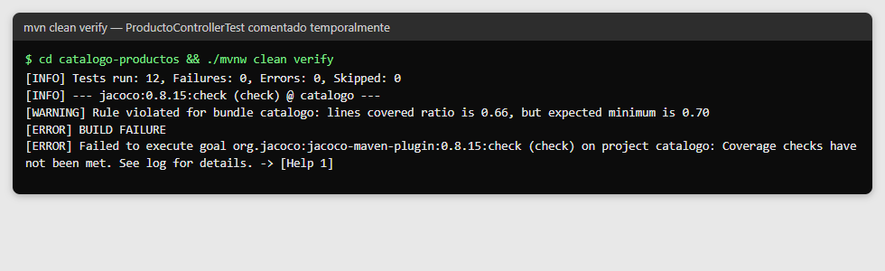
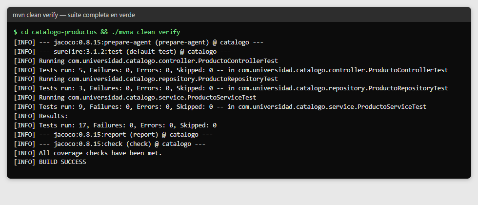
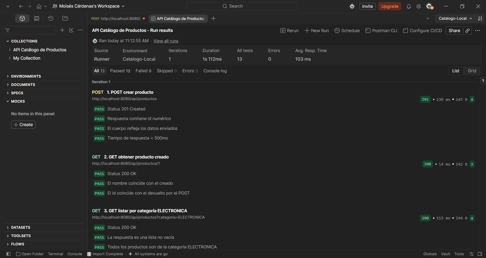
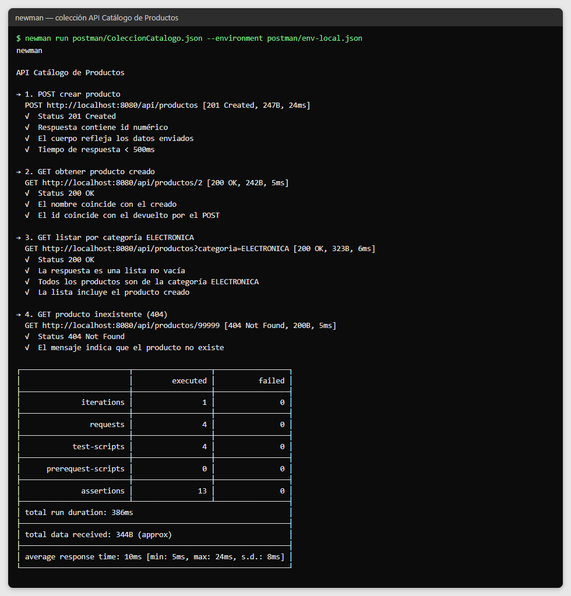

# Post-contenido — Unidad 10: Pruebas de Software en Aplicaciones Web

## Descripción
Repositorio del laboratorio de la Unidad 10 de Programación Web —
Séptimo Semestre. Contiene un único proyecto Maven Spring Boot
(`catalogo-productos/`) con una suite de pruebas unitarias, de
integración y de capa web sobre un catálogo de productos, más una
colección Postman versionada y un umbral de cobertura verificado
con JaCoCo.

**Tecnologías:** Java 17, Spring Boot 3.2.12, Spring Data JPA, H2, JUnit 5, Mockito, AssertJ,
MockMvc, Postman/Newman y JaCoCo.

**API bajo prueba:**

| Método | Ruta | Respuesta |
|---|---|---|
| POST | `/api/productos` | 201 con el producto creado; 400 si el nombre está vacío o el precio ≤ 0 |
| GET | `/api/productos/{id}` | 200 con el producto; 404 si no existe |
| GET | `/api/productos?categoria=X` | 200 con los productos de esa categoría |

## Estructura del proyecto
```
cardenas-post1-u10/
├── README.md
├── capturas/
├── postman/
│   ├── ColeccionCatalogo.json      ← colección "API Catálogo de Productos" (4 requests)
│   └── env-local.json              ← entorno "Catalogo-Local" (baseUrl)
└── catalogo-productos/
    ├── pom.xml                     ← JaCoCo con goal check (mínimo 70% de líneas)
    └── src/
        ├── main/java/com/universidad/catalogo/
        │   ├── model/Producto.java
        │   ├── repository/ProductoRepository.java
        │   ├── service/ProductoService.java
        │   └── controller/ProductoController.java
        └── test/java/com/universidad/catalogo/
            ├── service/ProductoServiceTest.java         ← unitaria (Mockito)
            ├── repository/ProductoRepositoryTest.java   ← integración (@DataJpaTest + H2)
            └── controller/ProductoControllerTest.java   ← capa web (@WebMvcTest + MockMvc)
```

## Parte 1 — Pruebas Unitarias con Mockito y de Integración con @DataJpaTest
`ProductoServiceTest` usa Mockito (`@Mock`, `@InjectMocks`) para probar la lógica de negocio en
aislamiento, cubriendo el caso feliz y los casos de error (precio inválido, nombre vacío, producto
no encontrado). `ProductoRepositoryTest` usa `@DataJpaTest` con H2 en memoria para probar las
consultas del repositorio.

### Propósito de cada clase de prueba
| Clase | Tipo | Herramienta | Por qué esa herramienta |
|---|---|---|---|
| `ProductoServiceTest` | Unitaria | `@ExtendWith(MockitoExtension.class)`, `@Mock`, `@InjectMocks` | El servicio contiene la lógica de negocio (validaciones). Con el repositorio simulado se prueba solo esa lógica, sin Spring ni base de datos, y se puede verificar que el repositorio **no** se invoca cuando un dato es inválido (`verify(repo, never()).save(any())`). |
| `ProductoRepositoryTest` | Integración | `@DataJpaTest`, `TestEntityManager`, H2 | Una consulta derivada como `findByCategoria` solo se puede probar contra una base real; `@DataJpaTest` levanta únicamente JPA y H2, y revierte cada test, así `setUp()` inserta siempre los mismos datos. |

**Pruebas de `ProductoServiceTest` (9):**
`crear_conDatosValidos_guardaYRetorna`, `crear_conPrecioNegativo_lanzaIllegalArgumentException`,
`crear_conNombreVacio_lanzaIllegalArgumentException`, `buscarPorId_existe_retornaProducto`,
`buscarPorId_noExiste_lanzaEntityNotFoundException`, `listarPorCategoria_conCategoria_retornaLoQueDevuelveElRepositorio`,
`actualizarPrecio_conValorValido_actualizaYGuarda`, `actualizarPrecio_conPrecioCero_lanzaIllegalArgumentException`,
`actualizarPrecio_productoNoExiste_lanzaEntityNotFoundException`.

**Pruebas de `ProductoRepositoryTest` (3):**
`findByCategoria_electronica_retornaUnProducto`, `findByCategoria_sinCoincidencias_retornaListaVacia`,
`save_productoNuevo_asignaIdYSePuedeRecuperar`.

## Parte 2 — Pruebas Web con @WebMvcTest, Postman/Newman y JaCoCo
`ProductoControllerTest` usa `@WebMvcTest` con `MockMvc` para probar la capa web sin levantar el
contexto completo. La colección Postman "API Catálogo de Productos" (`postman/ColeccionCatalogo.json`)
ejecuta 4 requests con test scripts contra la aplicación en ejecución real, y puede correrse también con
`newman run postman/ColeccionCatalogo.json --environment postman/env-local.json`.
JaCoCo verifica una cobertura mínima del 70% de líneas sobre todo el módulo con `mvn verify`.

| Clase / artefacto | Tipo | Herramienta | Por qué esa herramienta |
|---|---|---|---|
| `ProductoControllerTest` | Capa web | `@WebMvcTest`, `MockMvc`, `@MockBean` | Verifica rutas, serialización JSON y códigos HTTP (200, 201, 400, 404) del controlador, con el servicio simulado y sin abrir un puerto real. |
| `postman/ColeccionCatalogo.json` | Extremo a extremo | Postman / Newman | Prueba la API como caja negra, por HTTP real contra la aplicación en ejecución con su base H2 real. |

**Pruebas de `ProductoControllerTest` (5):** `get_productoExiste_retorna200`, `get_noExiste_retorna404`,
`getPorCategoria_conCategoria_retorna200ConLista`, `post_conDatosValidos_retorna201`, `post_conPrecioInvalido_retorna400`.

**Colección Postman (4 requests, 13 aserciones), en orden:**
1. `POST crear producto` → 201, id numérico (se guarda en la variable `productoId`), cuerpo con los datos enviados, tiempo < 500 ms.
2. `GET obtener producto creado` → 200, nombre "Teclado mecánico" e id igual al creado.
3. `GET listar por categoría ELECTRONICA` → 200, lista no vacía, todos de ELECTRONICA e incluye el producto creado.
4. `GET producto inexistente (404)` → 404 con el mensaje "Producto no encontrado".

### Cobertura con JaCoCo
`jacoco-maven-plugin` ejecuta `prepare-agent`, `report` (fase `test`) y `check` (fase `verify`) con la regla
`BUNDLE` / `LINE` / `COVEREDRATIO` mínimo `0.70`, excluyendo `*Application` y el paquete `model`.

- **Resultado final:** 17 pruebas en verde y `All coverage checks have been met`. Las clases medidas por
  el *gate* (`ProductoService` y `ProductoController`) tienen 100% de líneas cubiertas; el reporte, que
  también incluye `model` y la clase `Application`, muestra 96% de instrucciones en total.
- **Falla deliberada:** con `ProductoControllerTest` comentado temporalmente, la cobertura bajó a 66% y
  `mvn clean verify` falló con `Rule violated ... lines covered ratio is 0.66, but expected minimum is 0.70`
  y `BUILD FAILURE`. Luego se restauró el archivo y el build volvió a pasar.

### Orden en que se agregaron los tipos de prueba
1. **Unitarias del servicio** (Mockito): la base de la pirámide, rápidas y aisladas.
2. **Integración del repositorio** (`@DataJpaTest`): la consulta contra una base real.
3. **Capa web** (`@WebMvcTest`): el contrato HTTP del controlador, con el servicio simulado.
4. **Extremo a extremo** (Postman/Newman): la API completa en ejecución.
5. **JaCoCo** al final, para medir la cobertura agregada de las tres capas (ver decisión 6).

## Decisiones de diseño
1. H2 se usa también para ejecución local (no solo pruebas): el
   objetivo de la unidad es la escritura de pruebas, no el modelado
   de persistencia contra un motor externo como en la Unidad 8.
2. `buscarPorId` lanza `EntityNotFoundException` en vez de retornar
   null, para que el contrato del método sea explícito y verificable
   con `assertThrows`.
3. `ProductoRepositoryTest` usa `@DataJpaTest` en vez de `@SpringBootTest`
   para aislar la prueba a la capa de persistencia y mantener la
   suite rápida.
4. `ProductoControllerTest` usa `@WebMvcTest` en vez de `@SpringBootTest`
   con `TestRestTemplate`, para no duplicar cobertura con las pruebas
   de servicio y repositorio ya existentes.
5. La colección Postman se versiona como archivo .json, no como
   test JUnit, porque prueba el contrato HTTP completo como caja
   negra contra un proceso real, un nivel distinto al de MockMvc.
6. JaCoCo se configura al cierre de la Parte 2, no de la Parte 1,
   para medir la cobertura agregada de las tres capas y evitar que
   el umbral del 70% se cumpla artificialmente sobre una suite
   incompleta.
7. Este laboratorio NO incluye Selenium WebDriver: el dominio es una
   API REST pura sin vista Thymeleaf, y fabricar una vista solo para
   justificar Selenium contradiría la pirámide de pruebas. La
   colección Postman cumple el rol de prueba de extremo a extremo
   sobre la superficie real de la aplicación. En un proyecto con vistas
   Thymeleaf (como el catálogo de la Unidad 8), Selenium con Page Object
   Model sí sería la herramienta adecuada para un flujo de usuario real.

### Ajustes técnicos respecto a la guía
- **Byte Buddy 1.17.8** (`byte-buddy.version` en el `pom.xml`): `@MockBean ProductoService` simula una
  clase, no una interfaz, y la versión de Byte Buddy que trae Spring Boot 3.2 no soporta JDK 24+. Con
  la versión actualizada las pruebas corren en JDK 17 a 25.
- **JaCoCo 0.8.15** en lugar de 0.8.11: la 0.8.11 no reconoce clases de Java 22+ y, sobre JDK 25,
  lanzaba `Unsupported class file major version 69`. La configuración del umbral es la misma.
- **`spring-boot-starter-validation`**: aporta `jakarta.validation` para la anotación `@NotBlank` de `Producto`.
- **`spring.mvc.servlet.load-on-startup=1`**: el `DispatcherServlet` se inicializa al arrancar, de modo que
  la primera petición de la colección no pague ese costo y cumpla el test de tiempo < 500 ms.

## Cómo compilar y ejecutar
1. Clonar el repositorio: `git clone https://github.com/Moisex006/cardenas-post1-u10.git`
2. Ejecutar `./mvnw spring-boot:run` dentro de `catalogo-productos/`
3. Ejecutar la suite completa con verificación de cobertura:
   `./mvnw clean verify` (genera el reporte JaCoCo en
   `target/site/jacoco/index.html` y falla si la cobertura < 70%).
   Solo las pruebas: `./mvnw test`; una clase: `./mvnw test -Dtest=ProductoServiceTest`.
4. Con la aplicación en ejecución, correr la colección Postman:
   `newman run postman/ColeccionCatalogo.json --environment postman/env-local.json`
   (o importar ambos archivos en Postman y usar el Collection Runner).

## Capturas de pantalla
Reporte de cobertura JaCoCo (`target/site/jacoco/index.html`):



Detalle de `ProductoService`: líneas verdes cubiertas y una rama amarilla parcial:



Build fallando por cobertura insuficiente (evidencia del gate):



Tests unitarios, de integración y web en verde (`mvn clean verify`):



Postman Runner con 0 failures:



La misma colección ejecutada por línea de comandos con Newman:



Las capturas de `mvn` y `newman` muestran la salida real de los comandos; la de `mvn clean verify` está
filtrada a las líneas de pruebas, cobertura y resultado.
